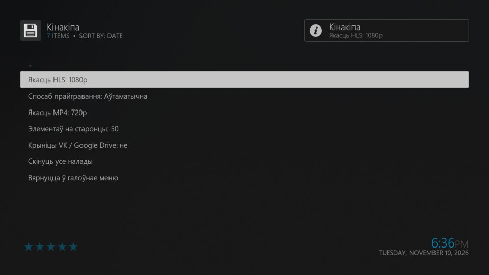
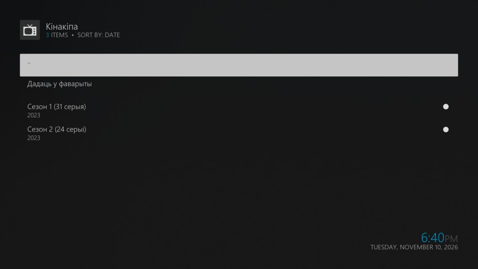
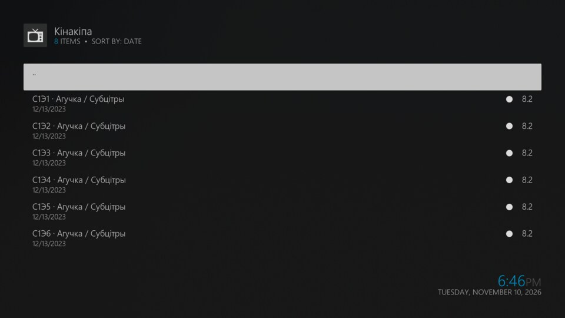
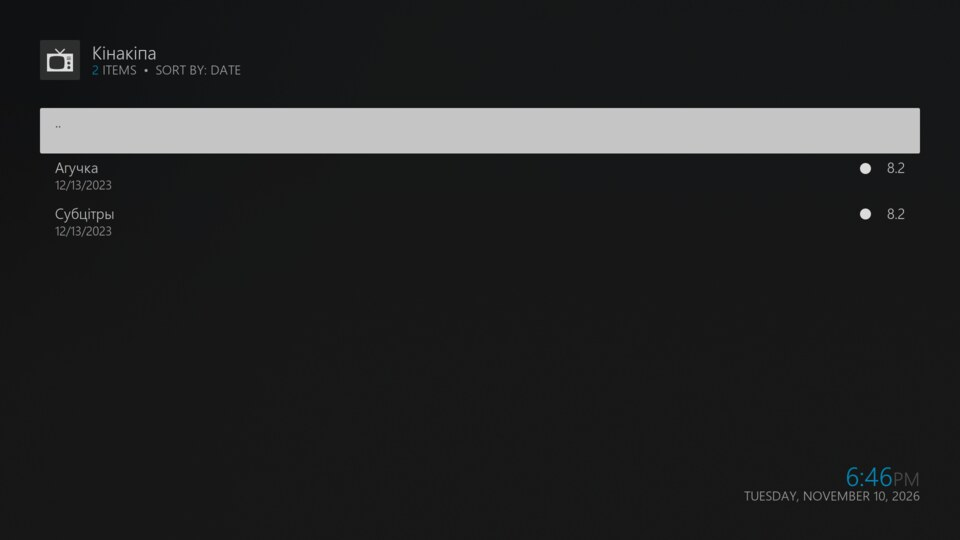
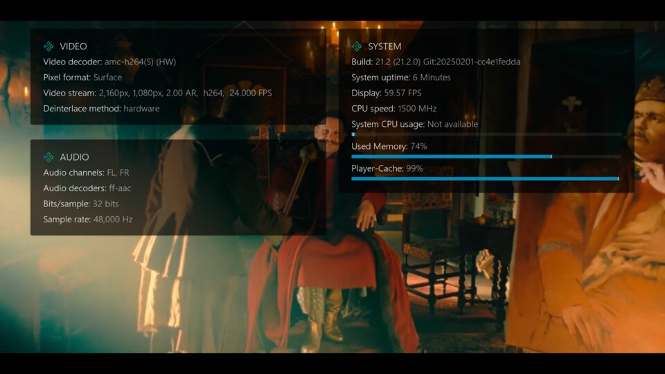

# Кінакіпа для Kodi

Відэададатак Kodi для прагляду фільмаў, серыялаў і мультфільмаў з беларускай агучкай
і субтытрамі з [kinakipa.site](https://kinakipa.site/).

## Магчымасці

- Галоўнае меню: пошук, новыя эпізоды, актуальныя рэлізы, фільмы, серыялы, мультфільмы
- Каталог з фільтрамі па жанрах, краінах і дыяпазонах гадоў
- Падгрузка старонак каталога («Далей — старонка N»)
- Тайтлы з некалькімі агучкамі, сезоны і серыі серыялаў
- Метаданыя: пастэр, фан-арт, апісанне, год, жанры, краіны, рэйтынгі, рэжысёры, акцёры
- Прайграванне HLS праз `inputstream.adaptive` з аўтаматычным пераходам на MP4
- Аўтаабнаўленні праз уласны рэпазітар
- Нуль знешніх залежнасцей — толькі стандартная бібліятэка Python

## Навігацыя

```
Галоўнае меню
├── Пошук
├── Фаварыты
├── Новыя эпізоды / Актуальныя рэлізы (раздзелы галоўнай старонкі)
├── Фільмы / Серыялы / Мультфільмы
├── Жанры / Краіны / Гады
├── Усе раздзелы галоўнай
├── Выпадковы тайтл
└── Налады
     └── Тайтл
          ├── ☆/★ Фаварыты
          ├── Агучкі (для фільма)
          └── Сезон → Серыя → Агучка / Субцітры
```

## Усталяванне

### Праз рэпазітар (рэкамендуецца — аўтаабнаўленні)

1. У Kodi: **Налады → Сістэма → Дадаткі** → уключыць **Невядомыя крыніцы**
2. Спампаваць `repository.kinakipa.zip` са [старонкі рэлізаў](https://github.com/artempl/kinakipa-kodi-plugin/releases)
3. **Налады → Дадаткі → Усталяваць з zip-файла** → абраць `repository.kinakipa.zip`
4. **Усталяваць з рэпазітара → Кінакіпа Repository → Відэададаткі → Кінакіпа → Усталяваць**

### Наўпрост з ZIP (без аўтаабнаўленняў)

Спампаваць `plugin.video.kinakipa.zip` са [старонкі рэлізаў](https://github.com/artempl/kinakipa-kodi-plugin/releases)
і ўсталяваць праз **Дадаткі → Усталяваць з zip-файла**.

## Скріншоты







## Налады

Налады адкрываюцца ўнутры плагіна: **Кінакіпа → Налады** (не праз сістэмны дыялог Kodi — на некаторых зборках Kodi 21 ён не бачыць `resources/settings.xml`).

| Налада | Па змаўчанні | Апісанне |
|---|---|---|
| Адрас сайта | `https://kinakipa.site` | Можна змяніць на люстэрка |
| Элементаў на старонцы | 50 | 20 / 50 / 100 |
| Спосаб прайгравання | Аўтаматычна | HLS калі ёсць `inputstream.adaptive`, інакш MP4 |
| Якасць HLS | Адаптыўна | Замацаваць пэўны ярус (1080p … 240p) на ўсё прайграванне |
| Якасць MP4 | 720p | Выкарыстоўваецца ў рэжыме MP4 |
| Паказваць крыніцы VK / Google Drive | не | Альтэрнатыўныя крыніцы, якія плагін не можа прайграць |
| Cookie для прэміум-кантэнту | — | Cookie з сайта для аўтарызаваных карыстальнікаў |

## Распрацоўка

Патрабуецца Python 3 і Kodi 19+. Поўнае апісанне архітэктуры і знойдзеных
API сайта — у [AGENTS.md](AGENTS.md).

```bash
# запуск інтэграцыйных праверок супраць жывога сайта
python3 tests/test_live.py

# зборка zip, addons.xml і md5 у pages/
./scripts/build.sh

# зборка з павышэннем версіі
./scripts/build.sh 1.0.1
```

## Ліцэнзія

GPL-2.0-or-later.

## Заўвага

Гэта неафіцыйны дадатак. Увесь кантэнт размяшчаецца на kinakipa.site, і правы на яго
належаць адпаведным уладальнікам. Плагін толькі чытае публічныя старонкі сайта.
